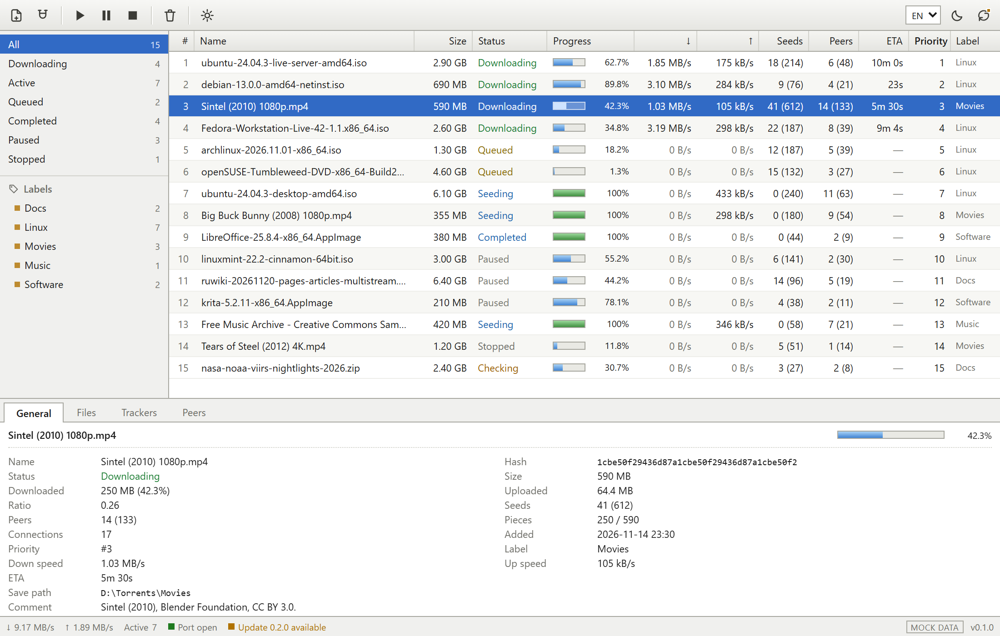

# Brickman Torrent

A small BitTorrent client for Windows. No ads, no toolbars, no telemetry.

The engine is [librqbit](https://github.com/ikatson/rqbit), the shell is Tauri 2,
the UI is plain TypeScript. MIT licensed.



## Download

Grab the installer from the [Releases](../../releases) page:

- `Brickman Torrent_x64-setup.exe` — normal installer
- `Brickman Torrent_x64_en-US.msi` — the same thing as an MSI

Windows 10 or 11, 64-bit. The app is not code-signed yet, so SmartScreen will
warn on the first run: *More info → Run anyway*.

## What it can do

- `.torrent` files and magnet links; DHT, HTTP/UDP trackers, PEX, local peer
  discovery
- downloads survive a restart — no re-check of finished files
- **the queue is the list**: the top row downloads and takes the whole
  bandwidth, the rest wait. Drag a row to move it up or down; there are also
  "Move up", "Move down" and "Move to position…" in the right-click menu
- "maximum active downloads" (default 1) decides how many run at once; a torrent
  that reaches 100 % leaves the queue, so the next one starts
- pick the download folder when you add a torrent, with the last five folders at
  hand; the folder is checked for write access before the download starts
- choose which files inside a torrent to download
- upload/download limits
- shut down, sleep or hibernate when all downloads finish — with a countdown you
  can cancel
- opens `magnet:` links and `.torrent` files (single instance, the link goes to
  the window that is already running)
- resizable columns, light and dark theme, 10 languages

There is no tray icon yet and no per-file priority levels — download or skip
only. See [SPEC.md](SPEC.md) for the full list of what is and is not there.

## Install

1. Run the installer.
2. Add a torrent: *Add file* for a `.torrent`, *Add link* for a magnet, or just
   click a magnet link in your browser after enabling it in
   *Settings → Links*.
3. Settings are stored per user; torrents and their progress live in
   `%APPDATA%\BrickmanTorrent\`.

## Command line

`brickman-torrent.exe` does one action and exits:

```
brickman-torrent add <file.torrent | magnet:?...> [--dir DIR] [--wait SECS]
brickman-torrent list
brickman-torrent pause <id|all>
brickman-torrent resume <id|all>
brickman-torrent rm <id> [--files]
brickman-torrent move <id> <position>
brickman-torrent up <id>
brickman-torrent down <id>
brickman-torrent limits [--down <KiB/s>] [--up <KiB/s>]
brickman-torrent max-active <n>
brickman-torrent run [--seconds SECS]
```

`add --wait N` and `run` keep the engine in the foreground for N seconds; the
rest only work while a command is running. State goes to
`%APPDATA%\BrickmanTorrent\` — override with `TC_DATA_DIR` and
`TC_DOWNLOAD_DIR`.

## Build from source

Rust 1.85+ (MSVC toolchain on Windows) and Node.js 20+.

The desktop crate embeds the frontend at compile time, so the frontend goes
first:

```sh
npm --prefix apps/desktop ci
npm --prefix apps/desktop run build      # writes apps/desktop/dist

cargo build --release
npm --prefix apps/desktop run tauri build  # installers in target/release/bundle
```

Checks:

```sh
cargo test
cargo clippy --all-targets -- -D warnings
npm --prefix apps/desktop run dev          # UI in a browser on mock data
npm --prefix apps/desktop run smoke        # UI smoke test against the dev server
```

Layout:

```
crates/core/          brickman-core: engine wrapper, queue, path checks
crates/cli/           brickman-cli: the command line tool
apps/desktop/         Tauri app: src-tauri (Rust shell) + src (TypeScript UI)
```

## Acceptable use

This is a protocol client. It contains no search, no catalogue, no index and no
tracker lists — it downloads only what you add yourself.

You are responsible for what you download and share. BitTorrent itself is legal
and is used for Linux distributions, open data and your own files; distributing
copyrighted works without permission is not.

## No telemetry

No analytics, no crash reports, no accounts. The only requests are BitTorrent
traffic and one update check against the GitHub releases feed, which can be
turned off in the settings.

## License

MIT — see [LICENSE](LICENSE).
