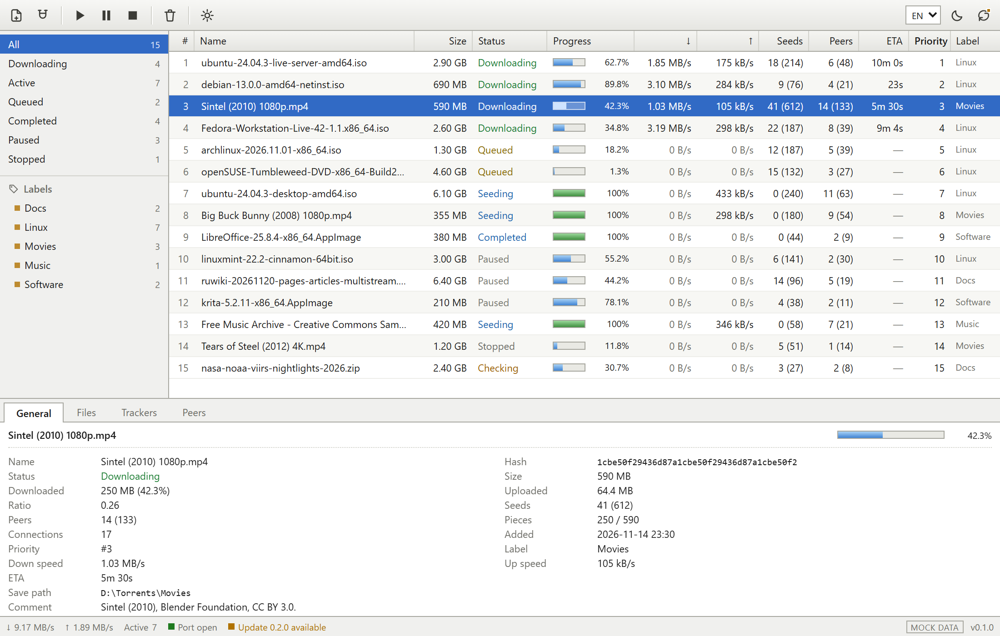

# Brickman Torrent

Небольшой торрент-клиент для Windows. Без рекламы, тулбаров и телеметрии.

Движок — [librqbit](https://github.com/ikatson/rqbit), оболочка — Tauri 2,
интерфейс на чистом TypeScript. Лицензия MIT.



## Скачать

Установщик лежит на странице [Releases](../../releases):

- `Brickman Torrent_x64-setup.exe` — обычный установщик
- `Brickman Torrent_x64_en-US.msi` — то же самое в виде MSI

Нужна Windows 10 или 11, 64 бита. Сборка пока без цифровой подписи, поэтому
SmartScreen при первом запуске покажет предупреждение: *Подробнее → Выполнить
всё равно*.

## Что умеет

- `.torrent` и magnet-ссылки; DHT, HTTP/UDP-трекеры, PEX, локальный поиск пиров
- загрузки переживают перезапуск — скачанное не проверяется заново
- **очередь — это список**: верхняя строка качается и забирает весь канал,
  остальные ждут. Строку можно перетащить выше или ниже; в меню по правой
  кнопке есть «В начало», «Выше», «Ниже» и «Перейти на позицию…»
- «максимум активных загрузок» (по умолчанию 1) решает, сколько качается
  одновременно; торрент, дошедший до 100 %, освобождает место следующему
- папка загрузки выбирается при добавлении, последние пять папок под рукой;
  до старта проверяется, что в папку можно писать
- выбор файлов внутри торрента: качать или пропустить
- лимиты отдачи и загрузки
- выключение, сон или гибернация после завершения всех загрузок — с обратным
  отсчётом, который можно отменить
- открывает ссылки `magnet:` и файлы `.torrent` (один экземпляр: ссылка уходит
  в уже открытое окно)
- тянущиеся колонки, светлая и тёмная тема, 10 языков

Трея пока нет, уровней приоритета файлов тоже — только «качать / не качать».
Что сделано и что нет — в [SPEC.md](SPEC.md).

## Установка

1. Запустить установщик.
2. Добавить торрент: «Добавить файл» для `.torrent`, «Добавить ссылку» для
   magnet — или просто нажать magnet-ссылку в браузере, включив это в
   «Настройки → Ссылки».
3. Настройки хранятся у пользователя, торренты и прогресс — в
   `%APPDATA%\BrickmanTorrent\`.

## Командная строка

`brickman-torrent.exe` выполняет одно действие и выходит:

```
brickman-torrent add <file.torrent | magnet:?...> [--dir DIR] [--wait SECS]
brickman-torrent list
brickman-torrent pause <id|all>
brickman-torrent resume <id|all>
brickman-torrent rm <id> [--files]
brickman-torrent move <id> <position>
brickman-torrent up <id>
brickman-torrent down <id>
brickman-torrent limits [--down <KiB/s>] [--up <KiB/s>]
brickman-torrent max-active <n>
brickman-torrent run [--seconds SECS]
```

`add --wait N` и `run` держат движок на переднем плане N секунд, остальные
команды работают только пока сами выполняются. Состояние — в
`%APPDATA%\BrickmanTorrent\`, переопределяется через `TC_DATA_DIR` и
`TC_DOWNLOAD_DIR`.

## Сборка

Нужны Rust 1.85+ (MSVC) и Node.js 20+. Фронтенд встраивается в бинарник при
компиляции, поэтому сначала он:

```sh
npm --prefix apps/desktop ci
npm --prefix apps/desktop run build

cargo build --release
npm --prefix apps/desktop run tauri build
```

Проверки:

```sh
cargo test
cargo clippy --all-targets -- -D warnings
npm --prefix apps/desktop run dev
npm --prefix apps/desktop run smoke
```

## Допустимое использование

Это клиент протокола. В нём нет поиска, каталога, индекса и списков трекеров —
он качает только то, что вы добавили сами.

Ответственность за скачанное и розданное — на вас. Сам BitTorrent легален: на
нём распространяют Linux-дистрибутивы, открытые данные и собственные файлы.
Распространение чужих произведений без разрешения — нет.

## Телеметрии нет

Ни аналитики, ни отчётов о падениях, ни аккаунтов. Сетевые запросы — это сам
BitTorrent и одна проверка обновлений на GitHub, которую можно отключить.

## Лицензия

MIT, см. [LICENSE](LICENSE).
