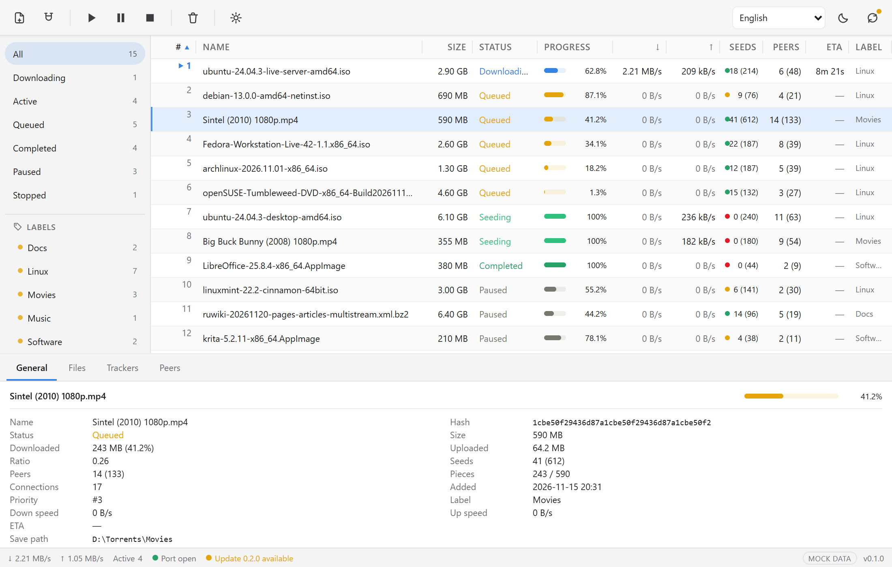

# brickman-torrent — Brickman Torrent UI prototype

Desktop torrent-client UI prototype (μTorrent-style): **Tauri 2 + Vite +
TypeScript**, plain DOM (no framework), mock data provider. The UI renders in a
normal browser (`npm run dev`) without the Tauri runtime, so the layout can be
reviewed before the engine is attached.

All sample torrents are legal/public content (see "Sample content" below).



## Stack / layout

- Tauri 2 (`src-tauri`, crate `brickman-torrent`, app **Brickman Torrent**,
  window 1100×700, min 900×560)
- Vite 8 + TypeScript (strict), one CSS file with theme variables
- No React/Svelte, no icon fonts, no CDN, no network calls, no telemetry
- Dense 24 px rows, classic light theme by default, dark theme toggle
- Resizable table columns: drag a header divider (6 px grab zone), double-click
  it to fit the column to its content, "Reset column widths" in the header
  context menu. The pixel widths are stored with the settings (`columnWidths`).
- UI strings live in `src/locales/*.json` with the micro-resolver `src/i18n.ts`
  (10 languages, switcher in the toolbar and in Settings → Appearance)

```
src/
  main.ts                 bootstrap: mock provider in browser, Tauri adapter in webview
  core/
    types.ts              Torrent / files / trackers / peers / stats / settings types
    provider.ts           TorrentProvider interface (the engine contract)
    mock-provider.ts      mock engine: ticking progress, speeds, queue, update check
    mock-data.ts          deterministic mock torrents, files, trackers, peers
    tauri-provider.ts     Tauri adapter (invoke) — commands listed below
    format.ts, settings.ts, version.ts
  ui/
    app.ts                shell, state, selection, sorting, menus, dialogs wiring
    table.ts              columns, sorting, rows
    details.ts            General / Files / Trackers / Peers
    settings-dialog.ts    queue, bandwidth, updates, appearance
    menu.ts, modal.ts, dom.ts, icons.ts
  locales/                  en.json, ru.json, es.json, pt-BR.json, de.json,
                            fr.json, it.json, tr.json, pl.json, zh-CN.json
src-tauri/                Cargo.toml, tauri.conf.json, capabilities, icons
scripts/screenshot.mjs    docs/mockup*.png via local Edge/Chrome (playwright-core)
scripts/smoke.mjs         90 interaction checks in headless Edge
scripts/check-locales.mjs every dictionary against en.json (keys + placeholders)
```

## Run

```bash
npm install
npm run dev          # http://127.0.0.1:1420 — plain browser, mock data
npm run build        # tsc --noEmit && vite build  -> dist/
npm run tauri dev    # desktop window (Rust toolchain, WebView2)
npm run tauri build  # installer (icons are already in src-tauri/icons)
```

Checks:

```bash
npm run build
cd src-tauri && cargo check
npm run smoke        # with `npm run dev` running in another terminal
npm run check:locales  # every dictionary vs en.json
npm run shot         # regenerates docs/mockup*.png
```

`smoke`/`shot` use `playwright-core` with the locally installed Edge
(`channel: 'msedge'`), i.e. no browser download. Icons: `assets/icon.png` is the
source, regenerate with `npx tauri icon assets/icon.png`.

If the Tauri commands are still missing, `resolveProvider()` in `src/main.ts`
falls back to the mock provider after a failed `list_torrents`, so
`npm run tauri dev` always shows a UI instead of an empty window.

## Localization

The UI ships in 10 languages: English, Русский, Español, Português (Brasil),
Deutsch, Français, Italiano, Türkçe, Polski and 简体中文. The switcher in the
toolbar and in Settings → Appearance lists each language in its own script; the
choice is saved with the other settings and applies at once.

- **English is the source language.** `src/locales/en.json` defines the key set,
  and every other file mirrors it key for key.
- The other nine dictionaries are machine translations with the torrent terms
  matched to the common clients (seeds/peers, semillas/pares, Sementes/Pares,
  Sources/Pairs, Seeds/Peers, Seedy/Peery, 种子/用户). No native speaker has
  reviewed them, so wording may still be off in places.
- A key missing from a dictionary falls back to English. The dev server logs one
  warning per missing key; the release build stays silent.
- To fix a string, edit that one JSON file: keys never change and
  `{placeholders}` must stay as they are. Then run `npm run check:locales`, which
  compares every dictionary with `en.json` (missing and extra keys, placeholders).
- Chinese relies on the CJK fallbacks in the font stack (`Microsoft YaHei`,
  `PingFang SC`, `Noto Sans CJK SC`).

## What is mocked

| Area | Mock behaviour | Real path later |
| --- | --- | --- |
| Torrent list | 15 deterministic legal torrents (distros, Blender films, public dumps, open-source apps, CC music), 1 s tick advances progress/downloaded/ETA/ratio | `list_torrents` |
| Queue | torrents beyond **max active** get `queued: true`, shown as "Queued" | engine scheduling |
| Sort | header click sorts the in-memory array (asc/desc) | client-side, unchanged |
| Toolbar actions | start/pause/stop/remove/add mutate the array | `resume_torrents`, `pause_torrents`, `stop_torrents`, `remove_torrents`, `add_torrent_file`, `add_magnet` |
| Priority | numeric, 1 = first; setting it re-indexes the queue | `set_priority` |
| Files | 2–12 generated files per torrent, checkbox = skip, 5-level dropdown | `list_files`, `set_file_priority` |
| Trackers/Peers | generated rows, test-net IPs (`192.0.2.*`, `198.51.100.*`, `203.0.113.*`) | `list_trackers`, `list_peers` |
| Status bar | sums, port open, version, mock badge | `get_session_stats` |
| Update check | 800 ms delay; answer toggled in Settings ("Simulate an available update") | `check_for_updates` |

Settings (theme, language, max active, limits, check-on-startup) and the column
widths persist in `localStorage` under `brickman-torrent.settings.v1`.

## Sample content

The mock dataset is legal/public content only — no commercial releases and no
scene names:

- **Linux**: Ubuntu 24.04.3 desktop and live-server, Debian 13 netinst, Fedora
  Workstation 42, Arch, openSUSE Tumbleweed, Linux Mint 22.2
- **Movies** (Blender Foundation, CC BY 3.0): Big Buck Bunny (2008) 1080p,
  Sintel (2010) 1080p, Tears of Steel (2012) 4K
- **Docs**: Russian Wikipedia dump (CC BY-SA 4.0), NASA/NOAA VIIRS night-lights
  dataset (public domain)
- **Software**: LibreOffice and Krita AppImages
- **Music**: a Creative Commons sampler (CC BY / CC BY-SA)

Labels: Linux, Movies, Docs, Software, Music. File names are plain
(`Big Buck Bunny (2008) 1080p.mp4`, `debian-13.0.0-amd64-netinst.iso`); there
are no `Sample` / `Subs` folders and no release-group suffixes.

## Update check (mock)

- Toolbar button **Check for updates** → status bar shows *Checking…*, then
  either *Update 0.2.0 available* (indicator + dialog) or
  *You have the latest version (0.1.0)*.
- Startup check runs ~1.2 s after launch when
  **Check for updates on startup** is enabled (default on; hint: "The only
  network request besides torrents themselves. Can be disabled.").
- Dialog: version, 3 changelog lines, **Download** (stub: `openExternal`, in the
  browser it logs to console and shows a toast) and **Later**.
- Mock function: `MockProvider.checkForUpdates()` in
  `src/core/mock-provider.ts` (line 192), mock answer switch:
  `MockProvider.mockHooks.setUpdateAvailable()` (line 36, settings checkbox).
  Changelog entries are i18n keys; `t()` falls back to the string itself, so a
  real API can return plain prose.

## Integration contract (what the UI waits for)

`src/core/tauri-provider.ts` maps 1:1 to these commands (camelCase args as in
the adapter):

| Command | Args | Returns |
| --- | --- | --- |
| `list_torrents` | — | `Torrent[]` |
| `get_session_stats` | — | `SessionStats` |
| `add_torrent_file` | `{ name?: string }` (real: file path) | `Torrent` |
| `add_magnet` | `{ uri: string }` | `Torrent` |
| `resume_torrents` / `pause_torrents` / `stop_torrents` | `{ ids: string[] }` | `void` |
| `remove_torrents` | `{ ids: string[], deleteData: boolean }` | `void` |
| `set_priority` | `{ id: string, priority: number }` | `void` |
| `set_max_active` | `{ maxActive: number }` | `void` |
| `set_limits` | `{ downLimit: number, upLimit: number }` kB/s, 0 = ∞ | `void` |
| `list_files` | `{ id: string }` | `TorrentFile[]` |
| `set_file_priority` | `{ id, fileId, priority }` (-1 skip … 3 maximum) | `void` |
| `list_trackers` | `{ id: string }` | `TrackerInfo[]` |
| `list_peers` | `{ id: string }` | `PeerInfo[]` |
| `check_for_updates` | — | `UpdateInfo` |
| `open_external` | `{ url: string }` | `void` |

Settings are pushed to the engine on startup and on Apply; the UI never keeps a
second source of truth for queue/limits.

**Polling.** `list_torrents` + `get_session_stats` are polled every **1 s**.
`list_files` is refreshed for the selected torrent each tick only while the
Files tab is open; `list_trackers` / `list_peers` are loaded on selection or tab
change. Recommended next step: emit a `torrents-updated` event from Rust at
≤5 Hz and drop the poll to a 2–5 s fallback; until then 1 s polling is fine for
a few hundred torrents.

**Update backend.** `check_for_updates` should perform the HTTPS release check
(timeout ~5 s) and return `{ available, currentVersion, version, changelog,
url, checkedAt }`. `open_external` should open the release page in the system
browser (Tauri opener plugin or `shell::open`).

## Verified

- `npm run build` — clean (tsc strict + vite)
- `cd src-tauri && cargo check` — clean (tauri 2.12.7)
- `npm run dev` — serves `index.html` with HTTP 200 at 127.0.0.1:1420
- `npm run smoke` — 25/25 interaction checks, no console/page errors
- `docs/mockup.png`, `docs/mockup-files.png`, `docs/mockup-dark.png` — headless
  Edge screenshots at 1100×700 @2x
